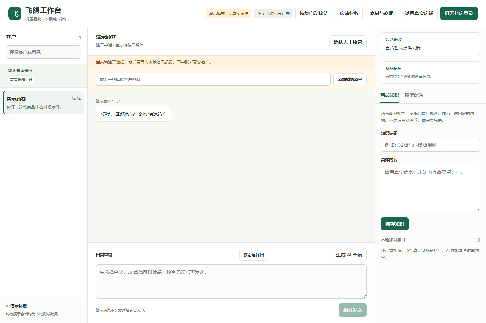

# FeigeDesk · 飞鸽客服工作台

面向抖店飞鸽的本地 AI 客服工作台：会话接待、回复草稿、商品知识和人工协助。

[](https://www.python.org/)
[](LICENSE)

独立 Windows 应用，通过专用 Chrome 会话与飞鸽页面协作，使用自己配置的 OpenAI 兼容模型服务。无需部署完整 eCan 应用，也不需要 eCan 账号。



> 截图使用独立演示数据。本项目不是抖店官方客户端，平台页面及协议变化可能影响功能。

## 功能概览

| 区域 | 功能 |
| --- | --- |
| 会话工作台 | 客户列表、消息记录、草稿编辑、人工回复、未读提示 |
| AI 接待 | 自有模型、可选自动回复、人工协助请求、确认接管与恢复 |
| 商品知识 | 本地商品资料、关键词检索、商品卡上下文 |
| 附件理解 | 图片、有限大小的 PDF 页面与视频抽帧，需模型支持视觉 |
| 店铺业务 | 官方业务信息查询、快捷回复读取、订单/商品相关适配入口 |
| 发送确认 | 核验会话及来源消息，保护已有人工草稿，等待平台回声确认 |

店铺业务与订单数据取决于官方权限和实际返回。部分非空订单、物流、售后及来源商品场景仍需真实店铺验收，不承诺全量覆盖。

## 安装与启动

准备 Windows、Python 3.12、Chrome；桌面窗口还需要 WebView2。

```powershell
git clone https://github.com/744219288/feigedesk.git
cd feigedesk
py -3.12 -m venv .venv
.venv\Scripts\python.exe -m pip install -r requirements.txt
.venv\Scripts\python.exe app.py
```

浏览器模式：`.venv\Scripts\python.exe app.py --browser`。全新数据目录首次进入演示模式；可通过 `--data-dir 路径` 隔离演示与日常数据。

## 接入真实店铺

1. 点击“打开抖店登录”，在专用 Chrome 中自行完成飞鸽登录，并保持该窗口打开。
2. 在“模型配置”填写兼容 OpenAI 的 API 地址、模型 ID 和 API Key，测试连接。
3. 在“商品知识”中录入真实规格、发货与售后规则。先用自己的测试会话核对接收、草稿与发送。
4. **模型初次配置保存后默认启用自动接待**；已保存的接待配置会在重启后恢复。需要停止时使用顶部“暂停自动接待”。
5. AI 请求人工协助不等于已经接管；点击“确认人工接管”才暂停该会话的 AI，之后可恢复。

不要在自动发送期间同时编辑专用飞鸽窗口的输入框。发送结果未知时不会自动重发，请在官方客户端核实。

## 开发与构建

```powershell
.venv\Scripts\python.exe -m unittest discover -s tests -v
.venv\Scripts\python.exe -m PyInstaller --noconfirm --clean FeigeDesk.spec
```

浏览器相关测试需要 Chrome。构建结果位于 `dist/FeigeDesk/`，运行时必须保留 `_internal` 目录。仓库不附带本机部署包或运行数据。

## 文档

- [工作面板与接待流程](docs/WORKBENCH.md)
- [架构与开发说明](docs/DEVELOPMENT.md)
- [验证记录](docs/VERIFICATION.md)
- [第三方来源](THIRD_PARTY_NOTICES.md) · [参与贡献](CONTRIBUTING.md) · [数据与安全](SECURITY.md)

## 数据与限制

会话、资料和浏览器档案留在本机 `data/`。API Key 使用 Windows 当前用户 DPAPI 加密，换电脑或用户需重新填写。云模型调用会发送当前对话、相关知识与已支持的附件内容给配置的服务。

本地知识检索不是向量 RAG；视频仅抽帧理解，不支持音轨转写，也不能保证覆盖每个瞬时事件。PDF 限 30 MiB / 24 页，视频限 100 MiB / 3 分钟，具体校验以源码为准。没有完整多店铺管理、自动退款或团队权限系统。

代码采用 [MIT](LICENSE)，保留 [eCan.ai 协议模块的原版权](vendor/feige/LICENSE)。另一个独立项目：[抖音私信客服工作台](https://github.com/744219288/douyin-inbox-desk)。
