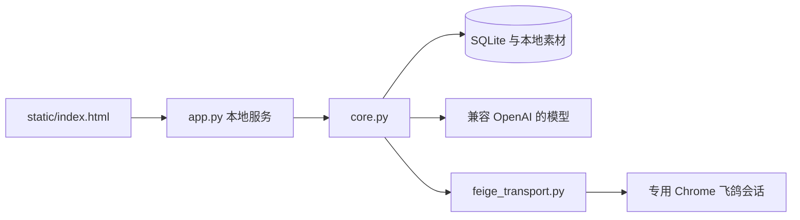

# 架构与开发

`core.py` 管理接待状态、草稿和知识。`native_sender.py` 对接官方编辑器，`transcript_sync.py` 统一消息归属，`inbox_journal.py` 处理入站记录。
`media_store.py`、`media_processing.py` 和 `model_media.py` 处理附件，`official_services.py`、`commerce_data.py` 和 `aftersale_data.py` 承接店铺业务数据。

使用 `python app.py --browser --data-dir <新的测试目录>` 进行界面开发。单元测试使用临时目录和模拟消息，DOM 测试使用离线页面。
修改发送链路时必须验证来源消息、会话身份、人工已有草稿、发送确认与未知结果；不能用昵称代替会话标识。
上游三个协议模块的固定版本和修改见 [vendor/feige/README.md](../vendor/feige/README.md)。
