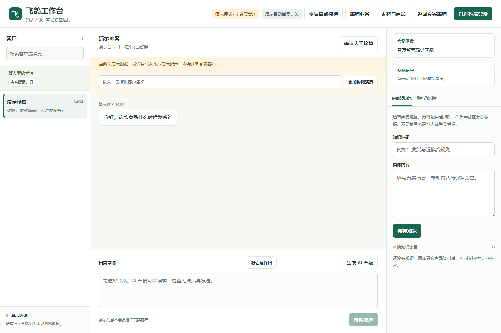

# 工作面板说明

## 面板分区

| 区域 | 工作内容 |
| --- | --- |
| 顶部操作栏 | 登录/连接、接待状态、暂停自动接待及店铺业务入口 |
| 左侧会话列表 | 查看客户及新消息，切换当前接待对象 |
| 中央对话区 | 阅读历史、查看商品上下文、生成与编辑草稿、发送消息 |
| 右侧工具区 | 商品知识与模型配置，按界面标签切换 |

## 推荐的首次使用流程

先使用全新演示数据体验面板，再登录专用飞鸽窗口，配置并测试模型，录入准确商品知识。
配置保存后可能启用自动接待，请先暂停并用自己的测试会话逐步验证。测试通过后再恢复日常接待。

## 草稿、协助与人工接管

手动生成草稿后先核对回复和当前客户；新消息会使旧草稿失效，避免发送过时答案。
“请求人工协助”只是后台提醒，AI 在人工确认前继续接待；“确认人工接管”才会暂停该客户的 AI。
处理完成后可以恢复 AI 接待。顶部暂停则控制整体自动接待。

## 商品与附件

商品卡或来源字段只有在会话归属可核实时才采用，不能据昵称推测客户或订单。
图片、PDF 页面和视频帧需要支持视觉的模型；纯文本连接测试不代表模型会看图。
附件下载、解析或输入超限会提示处理原因。不能把视频画面理解当作音频识别。

## 发送与业务查询

真实发送通过官方页面输入框完成，需保留专用窗口并避免同时编辑。
收到匹配的平台回声才确认送达；未知结果不自动重试。官方历史仅同步本次实际返回范围。
店铺业务信息受账号权限和接口返回影响；空结果、无权限与尚未验收的场景应分别判断。
